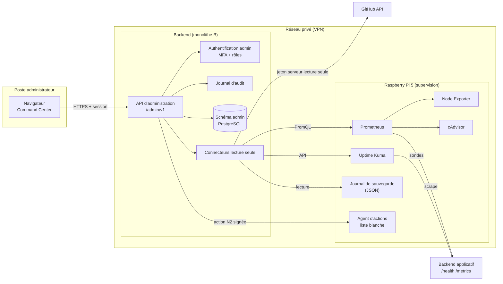
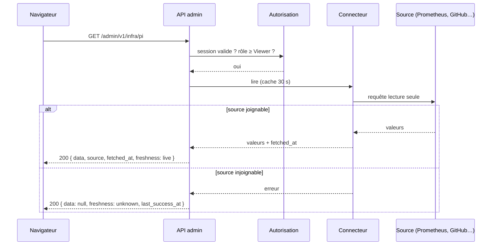
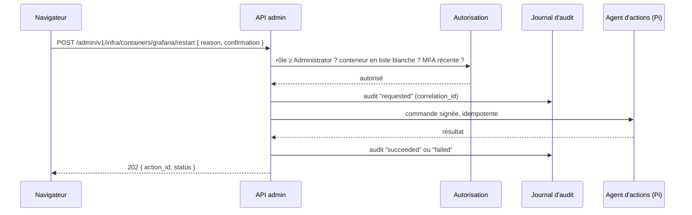

# Architecture d'administration

Ce document décrit comment les deux administrateurs pilotent KAIVIRO : le Command Center (front), l'API d'administration, le module `admin` du backend, les collecteurs de supervision et les flux entre eux.

Documents liés : [M0_PLAN](../roadmap/M0_PLAN.md) · [OBSERVABILITY_CONTRACT](OBSERVABILITY_CONTRACT.md) · [CRM_SPEC](../command-center/CRM_SPEC.md) · [ADMIN_PERMISSIONS](../security/ADMIN_PERMISSIONS.md) · [ADR-0010](../adr/ADR-0010-observabilite-et-pi.md) · [ADR-0012](../adr/ADR-0012-command-center-acces.md) · [ADR-0014](../adr/ADR-0014-stack-front-command-center-3d.md).

Contrats : [`packages/api-contracts/admin/openapi.yaml`](../../packages/api-contracts/admin/openapi.yaml) · [`packages/schemas/ops/`](../../packages/schemas/ops/README.md).

## 1. Principes

1. **Le navigateur ne parle qu'à l'API d'administration.** Jamais à Docker, PostgreSQL, Prometheus, Uptime Kuma ou GitHub.
2. **Jetons et secrets côté serveur uniquement.** Le front ne reçoit aucun jeton tiers.
3. **Autorisation côté serveur.** Le front masque, l'API refuse ([ADMIN_PERMISSIONS](../security/ADMIN_PERMISSIONS.md)).
4. **Chaque donnée porte sa provenance** : `source`, `fetched_at`, `freshness`, `demo`.
5. **Aucune donnée inconnue affichée comme saine.**
6. **La Pi supervise, elle ne produit pas.** Aucune donnée utilisateur de l'app ne transite par la Pi.
7. **Accès réseau privé uniquement** : VPN, aucun port d'administration public ([NETWORK_AND_VPN](../operations/NETWORK_AND_VPN.md)).

## 2. Composants

| Composant | Rôle | Propriétaire | Emplacement | Phase |
|---|---|---|---|---|
| Command Center (front) | Interface 2D, CRM, plus tard vue 3D | A | `apps/command-center` | CC-M1 |
| API d'administration | Façade unique du front ; agrège, autorise, journalise | A (spec) / B (implémentation dans le monolithe) | `services/backend`, module `admin` | CC-M1 |
| Module `admin` du backend | Comptes admin, rôles, CRM, incidents, audit, connecteurs | A (spec) / B (code) | `services/backend` | CC-M1 → CC-M3 |
| Connecteurs | Adaptateurs lecture seule vers GitHub, Prometheus, Uptime Kuma, journal de sauvegarde | A (spec) / B (code) | module `admin` | CC-M1 → CC-M2 |
| Pile de supervision | Uptime Kuma, Node Exporter, Prometheus, Grafana, cAdvisor, Loki | A | Raspberry Pi 5 | CC-M2 |
| Agent d'actions restreint | Exécute une liste blanche d'actions N2 (redémarrage de conteneur autorisé) | A | Pi, derrière l'API | CC-M3 |
| Schéma `admin` PostgreSQL | Tables admin, CRM, incidents, audit | A (spec) / B (persistance, ADR-0004) | base cloud | CC-M1 |

Hypothèse non tranchée : le module `admin` vit dans le monolithe de B (ADR-0003). Alternatives en §7.

## 3. Vue d'ensemble

## 4. Flux principaux

### 4.1 Lecture d'un indicateur

Une source en panne ne produit jamais une erreur 500 côté front. La réponse dit `unknown` et donne l'âge de la dernière mesure réussie.

### 4.2 Action contrôlée (niveau 2 ou 3)

Refus = 403 + audit `denied`. Aucune commande libre : l'agent n'accepte qu'un identifiant d'action connu.

### 4.3 Données de démonstration

Tant qu'une source n'est pas branchée, l'API peut servir un jeu de démonstration **versionné dans le dépôt**, marqué `demo: true`. Le front affiche alors le badge « Données de démonstration ». Pour les indicateurs de santé, une source absente donne `unknown`, jamais de la démo hors environnement de démonstration identifié.

## 5. Module `admin` du backend (spécification)

B implémente ; A spécifie. Frontière interne explicite : le module `admin` n'importe aucun module applicatif. Il lit l'application uniquement via les endpoints du [contrat de supervision](OBSERVABILITY_CONTRACT.md).

| Sous-module | Responsabilité | Tables (schéma `admin`) | Phase |
|---|---|---|---|
| `admin.identity` | Comptes admin nominatifs, rôles, MFA, sessions | `admins`, `admin_roles`, `admin_sessions` | CC-M1 |
| `admin.crm` | Partenaires, contacts, matériel de test | `partners`, `partner_events`, `test_equipment` | CC-M1 |
| `admin.sources` | Registre des sources S1–S9, état, dernière synchro | `sources` | CC-M1 |
| `admin.connectors` | Adaptateurs lecture seule, cache, limites de débit | aucune (cache mémoire) | CC-M1 → CC-M2 |
| `admin.incidents` | Incidents, chronologie, post-mortem | `incidents`, `incident_events` | CC-M3 |
| `admin.audit` | Journal en ajout seul | `audit_events` | CC-M1 (écriture) · CC-M3 (écran) |
| `admin.actions` | Liste blanche d'actions, exécution, idempotence | `action_runs` | CC-M3 |

Règles de persistance :

- `audit_events` en ajout seul : aucun `UPDATE`, aucun `DELETE` par l'application. Rétention dans [ADMIN_PERMISSIONS](../security/ADMIN_PERMISSIONS.md).
- RLS ou contrôle équivalent : seul le rôle technique de l'API écrit dans le schéma `admin`.
- Aucune table `admin` ne contient de donnée individuelle d'utilisateur de l'app.

## 6. Sécurité de la chaîne

| Point | Mesure |
|---|---|
| Accès réseau | API admin joignable uniquement via VPN (ADR-0012) |
| Authentification | Comptes nominatifs, MFA obligatoire, session courte |
| Autorisation | Rôle + périmètre + niveau d'action, vérifiés côté serveur |
| Jetons tiers | Stockés côté serveur (ADR-0011), lecture seule par défaut, portée minimale |
| Actions | Liste blanche, confirmation, motif, audit, idempotence |
| Agent d'actions sur la Pi | Écoute uniquement l'interface VPN, accepte des requêtes signées par l'API, pas de shell |
| Agents IA | Aucun agent IA n'a d'accès en écriture à l'API admin ([THREAT_MODEL](../security/THREAT_MODEL.md)) |

## 7. Alternatives étudiées

| Option | Avantages | Limites | Coûts | Risques |
|---|---|---|---|---|
| **A. Module `admin` dans le monolithe B** (proposé) | Une base de code, un déploiement, réutilise l'auth et la persistance | Cycle de release lié à l'app ; dépend du calendrier de B | Aucun surcoût | Une faille de l'app expose l'admin : frontière stricte requise |
| B. Service admin séparé servi depuis la Pi | Isolation forte, hors cloud | La Pi devient production pour l'admin ; disponibilité liée à la Pi | Aucun | Contredit « Pi jamais en production » si mal cadré |
| C. Routes serveur Next.js du Command Center | Rapide pour CC-M1 | Logique métier dans le front ; deux sources de vérité | Aucun | Jetons dans le même processus que le rendu |

Option C acceptable **uniquement** pour CC-M1 sur données de démonstration, si B n'est pas prêt. À trancher avec B (ADR-0003, ADR-0012).

## 8. Points ouverts

- Hébergement du Command Center : Vercel derrière accès privé, ou servi depuis la Pi via VPN (ADR-0014).
- Le module `admin` partage-t-il la base de l'app ou une base dédiée ? (ADR-0004, B).
- Fournisseur d'identité admin : celui de l'app (B) ou un fournisseur distinct ?
- Transport API → Pi pour les actions : tirage par l'agent (pull) ou appel direct (push) ? Le pull évite d'ouvrir un port sur la Pi.
