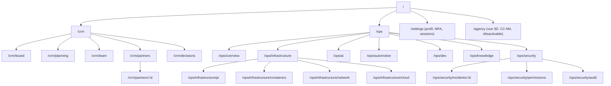

# Command Center — navigation 2D

Navigation complète, utilisable sans la vue 3D. La 3D (CC-M4) est une entrée de plus, jamais un passage obligé.

Documents liés : [COMMAND_CENTER_SPEC](COMMAND_CENTER_SPEC.md) · [CRM_SPEC](CRM_SPEC.md) · [DESIGN_SYSTEM](DESIGN_SYSTEM.md).

## 1. Coque

- **Barre latérale** (gauche, repliable) : logo, sélecteur d'espace (CRM / Opérations), liens de section avec compteurs, carte de rappel, compteur « Sources connectées x / 9 », avatars.
- **En-tête** : fil d'Ariane, recherche globale (Ctrl/⌘ K), bouton « Nouveau » (selon permissions), menu du compte (profil, déconnexion).
- **Zone principale** : contenu de la vue.

## 2. Arborescence et routes

- `/` redirige vers `/ops/overview`.
- Chaque route est partageable et restaurable (filtres dans l'URL).
- Une route interdite renvoie une page « Accès non autorisé », sans révéler le contenu.

## 3. Recherche globale (Ctrl/⌘ K)

- Cherche dans : livrables, décisions, partenaires (si autorisé), ADR, incidents, pages.
- Actions rapides : naviguer uniquement en CC-M1. Aucune action N2/N3 depuis la palette.
- Résultats filtrés côté serveur selon le rôle.

## 4. Raccourcis clavier

| Raccourci | Effet |
|---|---|
| Ctrl/⌘ K | Recherche globale |
| G puis O | Opérations · Synthèse |
| G puis C | CRM · Tableau |
| G puis I | Infrastructure |
| G puis S | Security & Incidents |
| ? | Aide des raccourcis |
| Échap | Fermer panneau ou dialogue |

Les raccourcis à une lettre sont désactivés quand le focus est dans un champ.

## 5. Accessibilité de la navigation

- Lien « Aller au contenu » en premier élément focalisable.
- Barre latérale : `<nav>` avec `aria-label`, élément courant en `aria-current="page"`.
- Ordre de tabulation : barre latérale, en-tête, contenu.
- Tout est accessible au clavier, focus visible teal 2 px.

## 6. Mobile

- Barre latérale remplacée par un tiroir (bouton menu) et une barre d'onglets basse : Synthèse, CRM, Infra, Incidents, Plus.
- Recherche en plein écran.
- Pas de survol requis pour accéder à une information.

## 7. Vue 3D

- Entrée « Agence » dans la barre latérale, visible seulement si la fonctionnalité est activée et WebGL disponible.
- Chaque objet de la scène renvoie à la route 2D équivalente. Retour 2D toujours visible.
