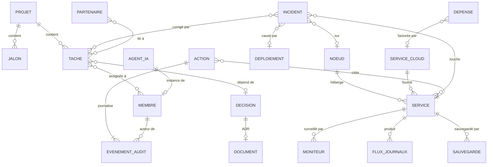

# KAIVIRO NEXUS — spécification fonctionnelle V2

Statut : PROPOSED, à valider par les deux humains avant tout développement (ADR-0016).

Une fois acceptée, cette spécification remplace :

- la structure de [COMMAND_CENTER_SPEC](COMMAND_CENTER_SPEC.md) et de [COMMAND_CENTER_NAVIGATION](COMMAND_CENTER_NAVIGATION.md) ;
- les §3 et §5 de [CRM_SPEC](CRM_SPEC.md).

Elle ne change pas :

- [ADMIN_ARCHITECTURE](../architecture/ADMIN_ARCHITECTURE.md) ;
- [ADMIN_PERMISSIONS](../security/ADMIN_PERMISSIONS.md) ;
- [OBSERVABILITY_CONTRACT](../architecture/OBSERVABILITY_CONTRACT.md) ;
- les règles de provenance de CRM_SPEC §1 et §4.

Contexte : le prototype CC-M1 (PR #1) juxtaposait un CRM et des tableaux de supervision. La PR a été fermée le 10/11/2026 et sa branche `feature/cc-m1-command-center` est conservée en archive. Le même jour, Johan est reparti de zéro avec un autre objectif : **un seul logiciel cohérent, pas un assemblage de dashboards.**

## 1. Positionnement

**Avant** : CRM d'administration + dashboard de supervision.
**Maintenant** : **Project Operations & Infrastructure Management Platform**. Elle sert les deux administrateurs de KAIVIRO et leurs deux instances Claude Code.

| Pilier | Objectif | Objets principaux |
|---|---|---|
| Business Operations | Projet, tâches, équipe, budget | Projet, Jalon, Tâche, Décision, Membre, Partenaire, Dépense |
| Infrastructure Operations | Serveurs, cloud, réseau, services | Nœud, Service cloud, Service, Réseau |
| Observability | Métriques, journaux, incidents, alertes | Moniteur, Flux de journaux, Incident, Alerte, Sauvegarde |
| Command Center | 3D, administration, sécurité, automatisation | Agent IA, Action, Événement d'audit, Document |

Chaque matin, NEXUS répond à trois questions sans changer d'application : où en est KAIVIRO, qu'est-ce qui casse, et que faire maintenant.

## 2. Principes non négociables

Ces six principes sont repris tels quels :

1. **Aucune donnée inconnue affichée comme saine.** Chaque valeur porte `source`, `fetched_at`, `freshness` et `demo` (CRM_SPEC §1).
2. **Le navigateur ne parle qu'à l'API d'administration.** Les jetons restent côté serveur (ADMIN_ARCHITECTURE §1).
3. **Les commandes sensibles passent par le backend, puis par l'agent d'actions de la Pi.** Elles sont sur liste blanche, signées et journalisées. Jamais de terminal, de commande libre ni d'accès direct depuis le navigateur (ADMIN_ARCHITECTURE §4.2, COMMAND_CENTER_SPEC §3).
4. **Les permissions sont vérifiées côté serveur**, avec les niveaux N1, N2 et N3 (ADMIN_PERMISSIONS).
5. **Minimisation** : aucune donnée individuelle d'utilisateur de l'app, seulement des agrégats.
6. **La 2D d'abord.** La 3D est une seconde façon de naviguer. Elle est désactivable et ne porte aucune fonction exclusive.

Quatre principes sont nouveaux en V2 :

- **7.** **Tout est un objet relié.** Un serveur, un service, un incident, une tâche ou un agent a sa fiche, ses relations et son historique. Aucune page isolée ne recalcule ses propres chiffres.
- **8.** **Une seule chronologie par objet.** L'activité, les changements, les incidents, les actions et l'audit apparaissent dans le même fil, du plus récent au plus ancien.
- **9.** **Les vues sont des réglages, pas des pages.** Une liste d'objets s'affiche en table, Kanban, calendrier ou carte, avec des filtres et des tris enregistrables.
- **10.** **Chaque champ a une seule source de vérité.** Un champ lu dans une source externe (GitHub, Prometheus…) n'est jamais modifiable dans NEXUS. Un champ propre à NEXUS est modifiable selon son niveau d'action.

## 3. Inspirations et limites

| Référence | Ce qu'on retient | Ce qu'on ne fait pas |
|---|---|---|
| Twenty (CRM open source) | Objets et relations, fiches détaillées avec chronologie, vues table et Kanban enregistrables, palette de commandes | Recopier son code ou ses composants. Sa licence copyleft est à vérifier par les humains ; aucune ligne n'est reprise |
| Cockpit Project (console Linux) | Lecture d'une machine par ressources : services, stockage, réseau, journaux, performances | Exposer un terminal ou des commandes libres dans le navigateur |
| « Bastion » (référence fournie par Johan) | Topologie, visualisation immersive, centre de commandement | L'utiliser comme modèle avant que la référence soit précisée (lien) |

Règle (ADR-0015, option C) : **l'inspiration seulement, aucun code tiers recopié**. L'identité visuelle reste celle de KAIVIRO. Elle sera redéfinie dans un DESIGN_SYSTEM V2.

## 4. Modèle d'objets

### 4.1 Objets

| Objet | Exemples | Source de vérité | Écriture dans NEXUS | Phase |
|---|---|---|---|---|
| Projet | KAIVIRO M0, M1 | NEXUS (schéma `admin`) | N2 | NX-1 |
| Jalon | Revue intermédiaire, tag m0.1.0 | NEXUS | N2 | NX-1 |
| Tâche | Un livrable, un correctif | S1 · GitHub Issues (labels actuels) | N2 via GitHub (statut, assignation) | NX-1 |
| Décision | ADR-0004 Supabase | S1/S2 · issue `decision` + fichier ADR | N2 (avis, trancher). L'ADR reste modifiée par PR | NX-1 |
| Membre | Johan, le collègue, Claude A, Claude B | NEXUS | N3 (rôles) | NX-1 |
| Partenaire / Contact | Garage, bêta-testeur | NEXUS (données personnelles, CRM_SPEC §5.8) | N2 ; suppression N3 | NX-1 |
| Dépense / Budget | Abonnement, matériel | NEXUS, saisie manuelle | N2 (Owner, Administrator) | NX-2 |
| Nœud | Raspberry Pi 5 | S5 · Node Exporter + fiche NEXUS | N2 pour les champs descriptifs | NX-2 |
| Service cloud | Supabase, Vercel, GitHub | NEXUS + connecteur si disponible | N2 | NX-2 |
| Service | Unité systemd, conteneur, API du backend | S5 (systemd, cAdvisor), S7 (`/health/details`) | Lecture seule ; actions par liste blanche | NX-2 |
| Moniteur | Sonde Uptime Kuma | S4 | Lecture seule | NX-2 |
| Flux de journaux | Journal d'un service | Loki (S5, à installer) | Lecture seule | NX-3 |
| Incident | Panne, alerte confirmée | NEXUS (INCIDENT_MANAGEMENT) | N2 (déclarer, traiter, clore) | NX-3 |
| Alerte | Seuil dépassé, sonde en échec | Règles Prometheus / Uptime Kuma | Lecture ; transformation en incident en N2 | NX-3 |
| Déploiement / Release | Tag, exécution CI | S1 · Actions, Releases | Relance d'une CI de la liste blanche en N2 | NX-2 |
| Sauvegarde | Passage restic, test de restauration | S6 · journal `backup-run` | Lecture seule | NX-2 |
| Agent IA | Claude A, Claude B, agents de M5 | NEXUS + contrat S9 | Lecture ; aucun accès en écriture à l'API (THREAT_MODEL) | NX-3 |
| Document | ADR, procédure, note | S2 · `docs/` | Lecture ; modification par PR | NX-1 |
| Action | « Redémarrer grafana » | Liste blanche de l'agent | N2 ou N3 selon l'action | NX-3 |
| Événement d'audit | Toute écriture N2/N3 | Journal d'audit (schéma `audit-event`) | Ajout seul, jamais modifié | NX-1 |

Les **objets personnalisables** permettraient aux admins de créer de nouveaux types d'objets, comme dans Twenty. Ils sont hors du périmètre de NX-1 à NX-3, et restent à trancher (§14).

### 4.2 Relations



Par exemple, un **incident** est lié au **service** touché, au **déploiement** qui l'a causé, au **nœud** qui l'héberge et à la **tâche** de correction. Depuis n'importe laquelle de ces fiches, on retrouve les autres en un clic.

## 5. Fiche d'objet

Chaque objet s'ouvre sur la même anatomie, en page pleine ou en panneau latéral depuis une liste.

| Zone | Contenu |
|---|---|
| En-tête | Nom, type, état (OK, Attention, Alerte, Inconnu), source et âge de la mesure, actions principales |
| Aperçu | Champs de l'objet, regroupés ; chaque champ externe affiche sa source |
| Relations | Objets liés, regroupés par type, avec leur état |
| Chronologie | Activité, changements de champ, incidents, actions et audit (principe 8) |
| Métriques | Si l'objet en a : séries temporelles sur la plage choisie |
| Journaux | Si l'objet en a : flux filtrable, en lecture seule |
| Actions | Actions de la liste blanche applicables, avec leur niveau, un motif obligatoire et une confirmation |

### Exemple : la fiche « Raspberry Pi 5 » (Nœud)

| Zone | Contenu | Source |
|---|---|---|
| Aperçu | Modèle, 16 Go de RAM, SSD de 512 Go (USB 3), refroidissement actif, Debian 13, adresse Tailscale | Fiche NEXUS (saisie) |
| Métriques | CPU, RAM, température, disque, réseau, charge, uptime | S5 · Node Exporter |
| Services | Unités systemd suivies (pile de supervision, Tailscale, SSH, Valheim) et conteneurs éventuels | S5 · systemd, cAdvisor |
| Disponibilité | Moniteurs Uptime Kuma liés | S4 |
| Incidents | Incidents liés au nœud | NEXUS |
| Journaux | Journaux des services | Loki (NX-3) |
| Sauvegardes | Dernier passage et dernier test de restauration | S6 |
| Actions | Au départ, une seule : redémarrer un service de la liste blanche (N2) | Agent d'actions |
| Chronologie | Interventions, actions, changements de fiche | Audit + NEXUS |

Tant que la supervision n'est pas installée sur la Pi, la fiche existe avec ses champs saisis. Toutes ses métriques sont alors « Inconnu », avec la raison.

Le même principe vaut pour Supabase, Vercel, l'API du backend, un agent IA ou une tâche.

## 6. Vues

| Vue | Usage | Objets typiques |
|---|---|---|
| Table | Tri, filtres, choix des colonnes, sélection multiple | Tous |
| Kanban | Avancement par étape ou par statut | Tâches, Partenaires, Incidents |
| Roadmap / calendrier | Fenêtres de dates, jalons, jour courant | Tâches, Jalons |
| Carte (topologie) | Nœuds, services et dépendances, état en couleur | Nœuds, Services, Services cloud |
| Chronologie | Fil d'événements filtrable | Journaux, Audit, Incidents |

Une vue enregistrée réunit un type d'objet, un affichage, des filtres, des tris et des colonnes. Chaque membre a ses vues personnelles. Les vues partagées sont créées par un Owner ou un Administrator (N2).

## 7. Navigation

```text
KAIVIRO NEXUS
├── WORKSPACE
│   ├── Overview                  (centre de pilotage, §8)
│   ├── Project Management        Projets, Jalons, Décisions
│   ├── Tasks & Roadmap           Tâches : Kanban, roadmap, table
│   ├── Finance & Budget          Dépenses, budget par poste
│   └── Team & Members            Membres humains et agents, charge, partenaires
├── INFRASTRUCTURE
│   ├── Infrastructure Map        Carte topologique de tous les nœuds et services
│   ├── Servers & Nodes           Nœuds (Raspberry Pi 5)
│   ├── Cloud Services            Supabase, Vercel, GitHub…
│   ├── Containers & Services     Services systemd, conteneurs, API
│   ├── Monitoring & Metrics      Moniteurs, métriques, alertes
│   ├── Logs & Incidents          Flux de journaux, incidents
│   └── Backups & Storage         Sauvegardes, tests de restauration, stockage
├── INTELLIGENCE & ADMINISTRATION
│   ├── AI & Agents               Agents IA, indicateurs agrégés (S9)
│   ├── Knowledge Center          Documents, ADR
│   ├── Security & Audit          Journal d'audit, accès, permissions
│   ├── Virtual Agency 3D         Seconde navigation (§10)
│   └── Settings                  Membres, rôles, sources, vues partagées
└── Profil : Administrateur · Owner · KAIVIRO
```

Chaque entrée ouvre une **liste d'objets** dans sa vue par défaut, et chaque ligne ouvre une **fiche**. Une page ne calcule rien de plus que ce que portent ses objets.

Éléments transverses :

- une palette de commandes (Ctrl/⌘ K) qui cherche dans tous les objets et lance les actions autorisées ;
- des raccourcis clavier, à reprendre de COMMAND_CENTER_NAVIGATION §4 ;
- un fil d'Ariane de la forme objet → relation → objet.

## 8. Overview : le centre de pilotage

Le but : comprendre la situation en quelques secondes, puis entrer dans le détail sans quitter l'application.

| Question | Bloc | Source | Sans source |
|---|---|---|---|
| Où en est KAIVIRO ? | Projet courant : jour du plan, jalon suivant, tâches terminées | Projet, Tâches (S1) | « Jour inconnu » |
| Qu'est-ce qui est en panne ? | Alertes et incidents ouverts, services en échec | Incidents, Alertes, Services (S4, S5, S7) | Chaque source muette est listée « Inconnu » |
| Quel budget est consommé ? | Dépenses du mois et cumul par poste | Dépenses (saisie) | « Aucune dépense enregistrée », jamais 0 € par défaut |
| Que reste-t-il à développer ? | Tâches ouvertes par projet et par mission, retards | Tâches (S1) | — |
| Qui travaille sur quoi ? | Membres et agents, avec leurs tâches en cours et leurs branches | Membres, Tâches, branches et PR (S1) | — |
| Quels sont les derniers incidents ? | Les cinq derniers incidents, avec état et service | Incidents | « Registre vide » |
| Les sauvegardes sont-elles bonnes ? | Dernier passage, dernier test de restauration, âge | Sauvegardes (S6) | « Jamais mesuré » |

Une liste unique, **« À traiter »**, trie le tout par gravité (alerte, puis attention, puis inconnu) et renvoie vers la fiche concernée.

## 9. Pages Infrastructure

| Page | Vue par défaut | Contenu |
|---|---|---|
| Infrastructure Map | Carte | Nœuds, services cloud et services reliés par leurs dépendances ; la couleur donne l'état ; un clic ouvre la fiche |
| Servers & Nodes | Table | Un nœud par ligne : état, CPU, RAM, température, disque, uptime |
| Cloud Services | Table | Service, rôle, statut du compte (créé, candidat, non créé), ADR liée, coût lié |
| Containers & Services | Table | Service, hôte, type (systemd, conteneur, API), état, dernier redémarrage, actions autorisées |
| Monitoring & Metrics | Tableau de séries | Métriques par nœud et par service, alertes actives, règles d'alerte |
| Logs & Incidents | Chronologie | Journaux filtrables (service, niveau, période) ; incidents en Kanban |
| Backups & Storage | Table | Passages, résultat, durée, dépôt, test de restauration, espace disque |

Aujourd'hui, seules la Raspberry Pi 5 (non supervisée) et GitHub existent. Supabase et Vercel sont des **candidats** (ADR-0004, ADR-0014) : leurs fiches les présentent comme tels, sans métrique ni statut inventé.

## 10. Virtual Agency 3D

C'est une seconde façon de naviguer, sur **les mêmes objets** :

- chaque zone est un bâtiment (Infrastructure Lab, Development Studio, AI Laboratory…), dont l'état vient des objets de la zone ;
- entrer dans un bâtiment ouvre la liste correspondante, et cliquer sur un élément ouvre sa fiche ;
- aucune action, aucune commande et aucun journal n'est disponible uniquement en 3D ;
- la 3D est désactivable, rendue à la demande, et respecte le mouvement réduit (COMMAND_CENTER_3D §2).

Le prototype CC-M1 (maquette d'architecte en R3F) sert de référence de comportement. Son code n'est pas à reprendre tel quel.

## 11. Sécurité et actions

L'architecture ne change pas :

1. navigateur ;
2. API d'administration ;
3. autorisation ;
4. audit ;
5. agent d'actions de la Pi, en pull de préférence (ADMIN_ARCHITECTURE §8) ;
6. résultat ;
7. audit.

La V2 ajoute ces lignes à la matrice d'ADMIN_PERMISSIONS (à intégrer par PR dans ce document) :

| Action | Niveau | Owner | Administrator | Developer | Viewer |
|---|---|---|---|---|---|
| Voir les dépenses et le budget | N1 | ✅ | ✅ | ❌ | ❌ |
| Créer ou modifier une dépense | N2 | ✅ | ✅ | ❌ | ❌ |
| Créer ou modifier une fiche nœud ou service cloud | N2 | ✅ | ✅ | ❌ | ❌ |
| Créer une vue partagée | N2 | ✅ | ✅ | ❌ | ❌ |
| Lier ou délier deux objets | N2 | ✅ | ✅ | ✅ | ❌ |
| Supprimer un objet propre à NEXUS | N3 | ✅ | ❌ | ❌ | ❌ |

Toute écriture N2 ou N3 crée un événement d'audit, visible dans la chronologie de l'objet.

## 12. Architecture fonctionnelle

### 12.1 API

L'API combine des endpoints d'objets génériques et des actions typées :

| Endpoint | Rôle |
|---|---|
| `GET /admin/v1/objects/{type}` | Liste avec filtres, tris, pagination et vue enregistrée |
| `GET /admin/v1/objects/{type}/{id}` | Fiche, avec la provenance de chaque champ |
| `GET /admin/v1/objects/{type}/{id}/relations` | Objets liés |
| `GET /admin/v1/objects/{type}/{id}/timeline` | Chronologie unifiée |
| `GET /admin/v1/objects/{type}/{id}/metrics?range=` | Séries temporelles (si applicable) |
| `PATCH /admin/v1/objects/{type}/{id}` | Champs propres à NEXUS (N2), motif obligatoire |
| `POST /admin/v1/relations` / `DELETE` | Lier ou délier deux objets (N2) |
| `POST /admin/v1/actions/{action_id}` | Action de la liste blanche (N2/N3) ; réponse `202 { action_id, status }` |
| `GET /admin/v1/overview` | Blocs du centre de pilotage, calculés à partir des objets |
| `GET /admin/v1/search?q=` | Palette de commandes |

Chaque réponse garde l'enveloppe de provenance du contrat M0 (`packages/schemas/ops/freshness`). Le contrat OpenAPI v0.3 sera régénéré à partir de cette liste.

### 12.2 Données

- **Objets propres à NEXUS** : schéma `admin` PostgreSQL, chez l'hébergeur retenu par ADR-0004.
- **Objets externes** : connecteurs en lecture seule (GitHub, Prometheus, Uptime Kuma, journal de sauvegarde, `/health/details`). Leurs données sont mises en cache, jamais recopiées comme vérité.
- **En attendant le backend de B** : des adaptateurs locaux côté serveur Next (fichiers JSON hors Git, comme en CC-M1), derrière la même interface. Rien ne sera à réécrire au branchement.

### 12.3 Front

La stack proposée est Next.js + TypeScript + Tailwind (ADR-0014, encore PROPOSED). Les composants de liste, de vue et de fiche sont **génériques**, paramétrés par un registre de types d'objets. Ajouter un type d'objet ne demande donc pas d'écrire une nouvelle page.

## 13. Phasage proposé

| Phase | Contenu | Prérequis |
|---|---|---|
| NX-0 | Validation de cette spec et d'ADR-0016 ; DESIGN_SYSTEM V2 ; maquette des écrans Overview, liste, fiche et carte | Humains |
| NX-1 | Coque, navigation, palette, registre d'objets, liste et fiche génériques ; objets Projet, Jalon, Tâche, Décision, Membre, Partenaire et Document ; audit ; Overview partielle | — |
| NX-2 | Nœud, Service cloud, Service, Moniteur, Sauvegarde, Déploiement, Dépense ; Infrastructure Map ; métriques | Supervision installée sur la Pi par Johan |
| NX-3 | Journaux (Loki), Incidents, Alertes, Actions via l'agent, Agents IA ; Virtual Agency 3D | Agent d'actions (CC-M3), authentification (ADR-0012) |
| NX-4 | Objets personnalisables, automatisations | Décision humaine |

La répartition suit ADMIN_ARCHITECTURE §2 :

- **mission A** : front NEXUS, spécifications, connecteurs, pile Pi proposée ;
- **mission B** : module `admin` du backend et sa persistance.

Aucun développement ne commence avant la validation de NX-0.

## 14. Points ouverts

1. **Nom** : « KAIVIRO NEXUS » remplace « Command Center » (ADR-0016). Les documents existants restent valides jusqu'à leur mise à jour.
2. **Budget** : saisie manuelle seulement, ou aussi import (relevés, factures) ? Avec quelles catégories ? Aucune dépense n'existe aujourd'hui, puisque la règle 5 de CLAUDE.md interdit tout service payant.
3. **« Bastion »** : il manque le lien exact de cette référence visuelle.
4. **Valheim sur la Pi** : CLAUDE.md réserve la Pi à l'administration et à la supervision, mais le serveur Valheim personnel y tourne déjà. Il faut consigner son statut : service personnel, hors KAIVIRO, affiché en lecture seule, jamais ciblé par une action.
5. **Objets personnalisables** : utiles pour deux personnes, ou complexité inutile avant NX-4 ?
6. **Licence de Twenty** : les humains la vérifient seulement si du code devait un jour être réutilisé. Par défaut, aucun code n'est repris.
7. **Données personnelles des partenaires** : les durées de conservation de CRM_SPEC §5.8 restent à valider.
8. **Documents à mettre à jour après acceptation** :
   - COMMAND_CENTER_SPEC, COMMAND_CENTER_NAVIGATION, CRM_SPEC, COMMAND_CENTER_3D et DESIGN_SYSTEM ;
   - ADMIN_PERMISSIONS (§11) ;
   - l'OpenAPI admin ;
   - la liste des ADR du M0_PLAN (fichier humain).
