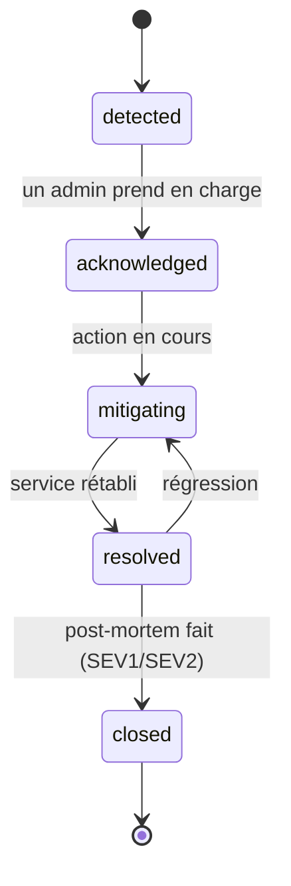

# Gestion des incidents

Schéma : [`incident.schema.json`](../../packages/schemas/ops/incident.schema.json). Écran : Security & Incidents ([COMMAND_CENTER_SPEC](../command-center/COMMAND_CENTER_SPEC.md)).

## 1. Gravités

| Gravité | Définition | Exemples | Prise en charge |
|---|---|---|---|
| SEV1 | Fuite de données ou de secret suspectée, compromission, app indisponible pour tous | Jeton publié dans Git, accès inconnu au VPN | immédiate, les deux admins prévenus |
| SEV2 | Fonction majeure dégradée, sauvegarde en échec répété | Synchronisation en panne, aucun backup depuis 72 h | dans la journée |
| SEV3 | Dégradation partielle, contournement possible | Pi indisponible (supervision aveugle) | sous 3 jours |
| SEV4 | Gêne mineure, cosmétique | Tableau de bord cassé | backlog |

Une fuite de secret est toujours SEV1, même sans exploitation constatée.

## 2. Cycle de vie

Chaque transition est journalisée (audit) avec son auteur.

## 3. Rôles

- **Responsable** : l'admin qui accuse réception. Il coordonne et rédige la chronologie.
- **Second** : l'autre admin, informé pour SEV1 et SEV2.
- Les instances Claude ne prennent pas de décision d'incident. Elles peuvent aider à rédiger le post-mortem à partir des faits fournis.

## 4. Secret exposé (procédure SEV1)

1. **Révoquer** le secret chez le fournisseur (avant tout nettoyage Git).
2. Émettre un nouveau secret, le stocker dans le coffre (ADR-0011).
3. Vérifier les journaux d'accès du fournisseur.
4. Nettoyer l'historique Git seulement si nécessaire, avec accord des deux humains.
5. Post-mortem.

## 5. Alertes

| Option | Avantages | Limites | Coût |
|---|---|---|---|
| **ntfy auto-hébergé** (proposé) | Simple, application Android, auto-hébergeable sur la Pi | Si la Pi tombe, plus d'alertes : prévoir une sonde externe | Gratuit |
| Courriel via SMTP | Universel | Identifiants SMTP à gérer | selon fournisseur |
| Notifications Uptime Kuma intégrées | Déjà présentes | Limitées aux sondes | Gratuit |

Règles proposées :

- Sujet ntfy privé, accès authentifié, joignable par VPN uniquement.
- Contenu des alertes : service, gravité, heure. Jamais de secret ni de donnée personnelle.
- Alerte « Pi muette » : à confier à une sonde extérieure à la Pi (décision humaine).
- Les seuils d'alerte sur les métriques sont fixés après observation réelle, pas avant.

## 6. Post-mortem

Obligatoire pour SEV1 et SEV2. Fichier `docs/operations/postmortems/AAAA-MM-JJ-titre.md`, sans blâme :

1. Résumé
2. Impact (durée, services, données)
3. Chronologie (UTC)
4. Cause racine
5. Ce qui a bien marché, ce qui a manqué
6. Actions correctives (issue GitHub chacune)

## 7. Communication

- Incident affectant des utilisateurs : message rédigé par les humains, validé par les deux.
- Incident de données personnelles : évaluer l'obligation de notification (RGPD, 72 h). Décision humaine.
