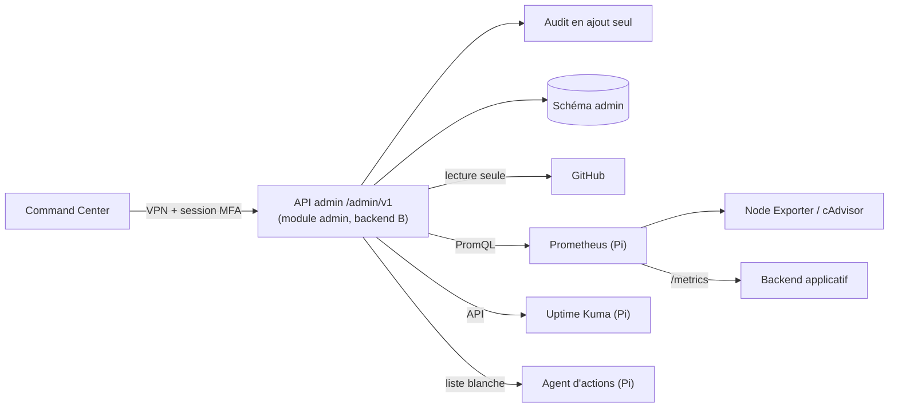

# Rapport M0 — Mission A (Administration & Opérations)

Branche `feature/m0-admin-operations`, worktree `kaiviro-claude-a`. Base : `develop` au commit `c66b4e6`.
Aucune interface développée, aucune commande exécutée sur la Pi, aucun compte ni ressource cloud, aucune dépendance installée, aucun secret.

## 1. Documents créés

### A1 — Analyse initiale

Inventaire de `develop` au 05/11/2026 : structure conforme au [M0_PLAN §2](M0_PLAN.md), dossiers vides avec `.gitkeep`, fichiers présents : `CLAUDE.md`, `README.md`, `M0_PLAN.md`, `CRM_SPEC.md` (v0.1), `.gitignore`, `scripts/init-kaiviro.ps1`. Aucun fichier supprimé hors `.gitkeep` des dossiers désormais remplis. Branche distante `feature/cc-m1-command-center` constatée, non touchée. Décisions ouvertes : voir §4.

### Fichiers

| Tâche | Fichier | Statut |
|---|---|---|
| A2 | [`docs/architecture/ADMIN_ARCHITECTURE.md`](../architecture/ADMIN_ARCHITECTURE.md) | DRAFT |
| A2 | [`docs/architecture/OBSERVABILITY_CONTRACT.md`](../architecture/OBSERVABILITY_CONTRACT.md) | PROPOSED |
| A2 | [`packages/api-contracts/admin/openapi.yaml`](../../packages/api-contracts/admin/openapi.yaml) + README | DRAFT |
| A2 | [`packages/schemas/ops/`](../../packages/schemas/ops/README.md) : freshness, service-health, metric, incident, audit-event, backup-run, deployment | DRAFT |
| A3 | [`COMMAND_CENTER_SPEC.md`](../command-center/COMMAND_CENTER_SPEC.md), [`COMMAND_CENTER_NAVIGATION.md`](../command-center/COMMAND_CENTER_NAVIGATION.md), [`DESIGN_SYSTEM.md`](../command-center/DESIGN_SYSTEM.md), [`COMMAND_CENTER_3D.md`](../command-center/COMMAND_CENTER_3D.md) | DRAFT |
| A4 | [`CRM_SPEC.md`](../command-center/CRM_SPEC.md) complété en v0.2 (non réécrit) | DRAFT |
| A5 | [`docs/operations/`](../operations/RASPBERRY_PI_ADMIN_CENTER.md) : RASPBERRY_PI_ADMIN_CENTER, CONTAINERS, NETWORK_AND_VPN, BACKUP_AND_RESTORE, INCIDENT_MANAGEMENT | DRAFT |
| A5 | `infrastructure/raspberry-pi/` (SSH, `check-host.sh`), `monitoring/` (Compose, Prometheus, `.env.example`), `network/` (nftables), `backups/` (restic, test de restauration, `.env.example`) | proposés |
| A6 | [`docs/security/`](../security/SECURITY_BASELINE.md) : SECURITY_BASELINE, THREAT_MODEL, ADMIN_PERMISSIONS, ACCESS_MANAGEMENT | DRAFT |
| A7 | [ADR-0001](../adr/ADR-0001-monorepo-et-collaboration.md), [0010](../adr/ADR-0010-observabilite-et-pi.md), [0011](../adr/ADR-0011-secrets-et-acces.md), [0012](../adr/ADR-0012-command-center-acces.md), [0014](../adr/ADR-0014-stack-front-command-center-3d.md), [0015](../adr/ADR-0015-crm-et-template-tiers.md) | PROPOSED |
| A8 | `.gitignore` (enrichi), `.gitattributes`, [`CONTRIBUTING.md`](../../CONTRIBUTING.md), [`SECURITY.md`](../../SECURITY.md), `.github/` (modèles d'issue et de PR, CODEOWNERS, dependabot, workflow `docs-checks`), `.markdownlint-cli2.yaml`, `.yamllint.yaml` | — |
| A8 | [`tests/contracts/admin/validate_contracts.py`](../../tests/contracts/admin/validate_contracts.py) + `requirements.txt` | — |
| A9 | `.claude/skills/` : command-center, admin-crm, raspberry-pi-ops, network-security, observability, release-management, security-audit, documentation-engineering | squelettes |

## 2. Architecture d'administration

Le navigateur ne parle qu'à l'API d'administration (`/admin/v1`). L'API vit dans le module `admin` du monolithe de B, spécifié par A. Elle authentifie (comptes nominatifs, MFA), autorise côté serveur, journalise, et interroge en lecture seule GitHub, Prometheus, Uptime Kuma et le journal de sauvegarde. Chaque réponse porte sa provenance (`source`, `fetched_at`, `freshness`, `demo`). Les actions N2 passent par un agent restreint sur la Pi, en liste blanche. Tout est derrière le VPN.

Détail et alternatives : [ADMIN_ARCHITECTURE](../architecture/ADMIN_ARCHITECTURE.md).

## 3. Périmètre CRM proposé et questions aux humains

| Module | Proposition | Phase |
|---|---|---|
| Pilotage du projet (Tableau, Planning, Équipe, Décisions) | Retenu | CC-M1 |
| Partenaires et contacts | Retenu, Administrator et Owner seulement | CC-M1 |
| Matériel de test (adaptateurs, téléphones, véhicules) | Retenu, sans VIN ni immatriculation par défaut | CC-M1 |
| Registre des accès admin | Retenu | CC-M3 |
| Retours et support agrégés | Reporté | M7 |

Questions :

1. Valider ou modifier ce périmètre (CRM_SPEC §5.0).
2. Étapes du pipeline partenaires : ajout de « Clos » ?
3. Durées de conservation proposées (CRM_SPEC §5.8) : 3 ans après clôture, 30 jours sans consentement.
4. Template : nom, licence, et choix A (vendor), B (dépôt séparé) ou C (réécriture) d'ADR-0015.
5. Accès serveur au vault Drive (S3) : compte de service ou OAuth, ou pas de S3 en CC-M1 ?
6. **Thème** : la maquette validée est claire (Ivoire), le prompt de mission demande « sombre ». Ivoire est le défaut, Nuit proposé en option, contrastes vérifiés pour les deux.

## 4. ADR proposées et points à trancher

| ADR | Proposition | À trancher |
|---|---|---|
| 0001 | Monorepo ; protection en M0 = règle écrite + hook `pre-push` + contrôle CI a posteriori, aucune dépense | Qui installe le hook chez le collègue ; versionner le hook ; seuil de passage payant ou public |
| 0010 | Pile progressive Uptime Kuma → Prometheus/Node Exporter/cAdvisor → Grafana → Loki, ntfy | Sonde externe pour la Pi ; rétention ; collecteur Loki |
| 0011 | Coffre KeePassXC chiffré, fichiers secrets `0400` au runtime, rotation annuelle | Validation du coffre ; emplacement des copies du fichier clé |
| 0012 | VPN uniquement, comptes admin nominatifs + MFA, autorisation serveur, audit | Fournisseur d'identité admin ; double validation N3 |
| 0014 | Next.js + TypeScript, Tailwind, Motion ; 3D en React Three Fiber (CC-M4) ; servi depuis la Pi via VPN en CC-M1/CC-M2 | SSR ou export statique ; hébergement à CC-M3 |
| 0015 | CRM intégré, schéma `admin` ; template isolé ou réécrit | Licence, choix A/B/C, dépôt public ou non |

Autres décisions ouvertes : WireGuard ou Tailscale (CGNAT à vérifier), destination hors site des sauvegardes, nom KAIVIRO (ADR-0013, humains).

## 5. Attentes envers la mission B

1. **Contrat de supervision** : répondre à [OBSERVABILITY_CONTRACT](../architecture/OBSERVABILITY_CONTRACT.md) §9 et l'intégrer dans `API_CONTRACTS` : `/health`, `/health/details`, `/metrics`, `/version`, liste fermée des `module` et `kind` d'erreur, authentification de `/metrics`, indicateurs mobiles retenus.
2. **Module `admin` du backend** : implémenter selon [ADMIN_ARCHITECTURE §5](../architecture/ADMIN_ARCHITECTURE.md) et l'[OpenAPI](../../packages/api-contracts/admin/openapi.yaml). Frontière stricte : `admin` n'importe aucun module applicatif. Audit en ajout seul.
3. **Authentification** : rôle admin distinct des utilisateurs de l'app, MFA, sessions courtes (ADR-0012). Préciser le fournisseur retenu.
4. **Persistance** : schéma `admin` dans la base retenue par ADR-0004, avec RLS ou équivalent.
5. **Données** : DATA_CLASSIFICATION doit couvrir les données du CRM (partenaires, bêta-testeurs) et les agrégats affichés.
6. **IA** : métriques de la passerelle sans contenu de conversation (§4 du contrat).
7. **Calendrier** : si le module `admin` n'est pas prêt pour CC-M1, accord sur l'option C provisoire (routes serveur du Command Center sur données de démonstration, en local).

## 6. Propositions croisées

Aucun fichier de B ni des humains n'a été modifié.

| Fichier | Propriétaire | Proposition |
|---|---|---|
| `docs/architecture/API_CONTRACTS.md` | B | Référencer `OBSERVABILITY_CONTRACT` et `packages/api-contracts/admin/` ; ajouter les endpoints de supervision |
| `docs/security/DATA_CLASSIFICATION.md` | B | Ajouter une classe « données CRM d'administration » et les agrégats du Command Center |
| `docs/architecture/DEPLOYMENT_MODEL.md` | B | Mentionner la Pi comme hôte de supervision et, si ADR-0014 est acceptée, du Command Center statique |
| `CLAUDE.md` | humains | §3 : la règle 11 est placée entre 6 et 7, renuméroter. §6 : préciser si l'en-tête YAML s'applique aussi aux ADR (la mission A a mis les deux) |
| `CLAUDE.md`, `README.md`, `M0_PLAN.md` | humains | Lint : blocs de code sans langage (MD040), titres et listes sans ligne vide autour (MD022, MD032). Relevés par la CI : 11 écarts dans CLAUDE.md, 4 dans README.md, 8 dans M0_PLAN.md (run 42001446382). Ces trois fichiers sont **exclus** de markdownlint dans `.markdownlint-cli2.yaml` pour respecter la matrice de propriété. Après correction par les humains, retirer les trois lignes `ignores` |
| `README.md` | humains | « open source » alors que le dépôt est privé : préciser (impact ADR-0015) |
| `scripts/` | humains | Versionner le hook `pre-push` (ex. `scripts/git-hooks/pre-push`) et l'activer par `core.hooksPath` (ADR-0001) |

## 7. Procédure Pi prête à appliquer par Johan

Ordre (détail : [RASPBERRY_PI_ADMIN_CENTER §4](../operations/RASPBERRY_PI_ADMIN_CENTER.md)) :

1. Raspberry Pi OS Lite 64 bits sur SSD (Imager : utilisateur nominatif, clé SSH seule).
2. Démarrage sur SSD, `apt full-upgrade`, `rpi-eeprom-update`.
3. Comptes nominatifs, groupe `kaiviro-admins`, `sudo` avec mot de passe.
4. SSH : `10-kaiviro-hardening.conf`, `sshd -t`, test dans une seconde session.
5. Relever : CGNAT ou non, possibilité de redirection UDP, plage LAN.
6. VPN selon décision (WireGuard proposé, Tailscale en repli).
7. Pare-feu `nftables.conf` adapté, appliqué avec filet de retour arrière.
8. `unattended-upgrades`.
9. Docker Engine (dépôt officiel), sans groupe `docker` pour les admins.
10. Vérifier tags et digests arm64, puis `compose --profile uptime up -d`.
11. `check-host.sh` : tout en OK.
12. restic, dépôt local chiffré, mot de passe dans le coffre ; `backup.sh pi-config local`.
13. **`restore-test.sh pi-config local` : restauration de test réussie.**
14. Étape suivante (`metrics`) seulement après mesure des ressources.

Contrôles attendus après chaque étape : tableau de [RASPBERRY_PI_ADMIN_CENTER §5](../operations/RASPBERRY_PI_ADMIN_CENTER.md). Résultats à consigner dans une issue `ops`.

## 8. Risques

| Risque | Niveau | Mesure |
|---|---|---|
| Pas de protection de branche (GitHub Free privé) : push direct par erreur | Moyen | Hook local, règle écrite, contrôle CI a posteriori (ADR-0001) |
| Licence du template inconnue ; dépôt peut devenir public | Moyen | ADR-0015 : isolation ou réécriture, purge d'historique avant ouverture |
| CGNAT empêchant WireGuard | Moyen | Repli Tailscale (compte créé par les humains) |
| Pi unique : supervision aveugle en cas de panne | Moyen | La Pi n'est pas critique pour l'app ; sonde externe à décider |
| Calendrier B : module `admin` non prêt pour CC-M1 | Moyen | Option C provisoire en local sur démo |
| Tags d'images non vérifiés sur arm64, digests absents | Faible | Vérification par Johan avant tout lancement |
| Fichiers humains exclus du lint Markdown : régressions invisibles | Faible | Corrections proposées en §6, exclusion à retirer ensuite |
| Contradiction thème clair (maquette) / sombre (prompt) | Faible | Ivoire par défaut, Nuit en option, décision humaine |
| Données personnelles de partenaires dans le CRM | Moyen | Rôles, minimisation, conservation limitée |

## 9. Contrôles exécutés et résultats

Date : 05/11/2026, poste Windows de Johan, sans installation d'outil.

| Contrôle | Outil | Résultat |
|---|---|---|
| Lint Markdown (sous-ensemble : MD001, MD009, MD010, MD012, MD022, MD025, MD031, MD040, MD047) | script Python local (scratchpad, non versionné) | Fichiers de la mission A : **0 écart** après correction (ADR-0012, CRM_SPEC). Fichiers humains : 10 écarts, listés en §6 |
| markdownlint-cli2 complet | non disponible localement | Non exécuté. Tournera en CI (`docs-checks`) |
| Liens relatifs Markdown | script Python local | **0 lien cassé** dans les fichiers de A. 1 faux positif dans `CLAUDE.md` (exemple en code inline) |
| lychee | non disponible localement | Non exécuté. Tournera en CI, hors ligne |
| En-têtes YAML des documents | script Python local | **0 écart** après correction du titre d'ADR-0012 (deux-points non échappé) |
| Parse YAML (tous les `.yml`/`.yaml`) | PyYAML 6.0.3 | **OK** |
| Parse JSON (schémas) | Python `json` | **OK**, 7 fichiers |
| Contrats : `$ref` externes de l'OpenAPI, rôle et niveau sur chaque opération | `validate_contracts.py` | **OK**, 0 erreur |
| Méta-validation JSON Schema, exemples et contre-exemples | `validate_contracts.py` (jsonschema) | **SKIP** : jsonschema absent localement. Exécuté en CI avec `--strict` |
| Validation OpenAPI 3.1 complète | `validate_contracts.py` (openapi-spec-validator) | **SKIP** localement. Exécuté en CI |
| Scan de secrets (motifs AWS, GitHub, clés privées, JWT, `sk-`, WireGuard, affectations) | script Python local sur tous les fichiers suivis | **0 détection** |
| gitleaks | non disponible localement | Non exécuté. Tournera en CI |
| Syntaxe des scripts shell | `bash -n` | **OK**, 3 scripts |
| shellcheck | absent | Non exécuté |
| Compose | `docker compose config -q` (v5.4.0, sans démarrer de conteneur) | **OK** pour `uptime` seul et pour tous les profils. Défaut corrigé : le profil `uptime` exigeait les variables Grafana |
| nftables | `nft -c` indisponible sous Windows | Non exécuté. À faire par Johan sur la Pi |
| Matrice de propriété | `git diff origin/develop...HEAD` | **Aucun fichier de B ni des humains modifié** |
| Contrastes WCAG | calcul de luminance relative (script local) | 23 paires vérifiées, toutes ≥ 4,5:1 ([DESIGN_SYSTEM §2.4](../command-center/DESIGN_SYSTEM.md)) |

Première exécution de la CI sur la PR (run 42001446382) : 3 contrôles sur 5 en échec, tous liés à la configuration. Corrections :

- scan de secrets : permission `pull-requests: read` ajoutée au job (403 sur la liste des commits de la PR) ;
- lychee : option `--include-fragments=false` invalide retirée ;
- markdownlint : `MD025` ignore désormais le `title:` de l'en-tête YAML ; les trois fichiers humains sont exclus (§6).

Versions relevées en ligne (API GitHub publique, PyPI), en lecture seule : SHA des actions GitHub, dernières releases des images Docker, versions des validateurs Python. À revérifier au moment de l'application.

## 10. Backlog proposé

### CC-M1 — Command Center 2D + CRM sur données de démonstration identifiées

1. Valider ADR-0014 et ADR-0015 ; décider du thème ; fournir la licence du template.
2. Convention de labels GitHub (`mission:*`, `type:*`, `status:*`, `decision`) et création du GitHub Project.
3. Coque, navigation, recherche, design system en jetons (Ivoire, Nuit en option).
4. Composants d'état : badge de fraîcheur, indicateur de santé, états inconnu/démo/erreur.
5. Jeu de données de démonstration versionné, marqué `demo: true`.
6. CRM : Tableau, Planning, Équipe, Décisions sur S1/S2 (lecture), Partenaires et matériel sur S8.
7. Opérations en 2D avec états « inconnu » et tableau des sources.
8. Tests d'accessibilité automatiques en CI.
9. Confronter le prototype `feature/cc-m1-command-center` à ces spécifications.

### CC-M2 — Supervision réelle depuis la Pi

1. Pi étapes 0 à 3 appliquées par Johan, test de restauration réussi.
2. Connecteurs API admin : Uptime Kuma (S4), Prometheus (S5), journal de sauvegarde (S6).
3. Endpoints de B branchés (S7) : `/health/details`, `/metrics`, `/version`.
4. Executive Overview et Infrastructure en données réelles.
5. Collecteur textfile pour le throttling (`vcgencmd`) vers Node Exporter.
6. ntfy et premières alertes, seuils fixés après observation.
7. Scan externe « zéro port exposé » affiché avec sa date.
8. Contrôle CI : commit arrivé sur `develop` sans PR (ADR-0001).
