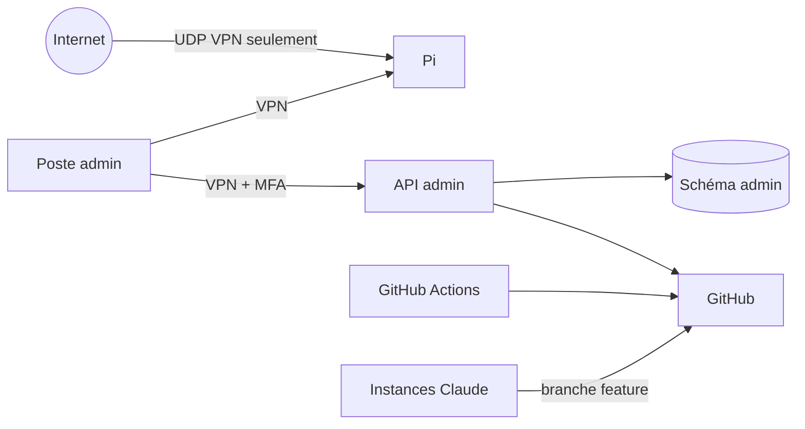

# Modèle de menaces

Méthode : STRIDE par zone, puis mesures. Périmètre : infrastructure, Command Center, API d'administration, CI, agents IA côté admin. L'application relève de B.

## 1. Actifs

| Actif | Sensibilité |
|---|---|
| Secrets (jetons GitHub, cloud, clés VPN, mot de passe des sauvegardes) | critique |
| Comptes administrateurs | critique |
| Schéma `admin` (CRM, audit, incidents) | élevée (données personnelles de partenaires) |
| Dépôt Git et CI | élevée (intégrité du code) |
| Pi et sa supervision | moyenne (visibilité, point d'entrée VPN) |
| Sauvegardes | élevée (contiennent des clés VPN) |

## 2. Zones et flux

Frontières de confiance : Internet / VPN, navigateur / API, API / Pi, CI / dépôt, agent IA / dépôt.

## 3. Menaces et mesures

| # | Zone | STRIDE | Menace | Mesure | Résiduel |
|---|---|---|---|---|---|
| T-01 | Réseau | S, E | Accès à un service d'admin exposé par erreur | Pare-feu `drop`, ports liés à l'IP VPN, scan externe | Faible |
| T-02 | Réseau | I | Piège Docker : port publié qui contourne le pare-feu | Règle `BIND_ADDR`, `check-host.sh` | Faible |
| T-03 | Pi | E | Compromission SSH | Clé seule, pas de root, groupe restreint, journal VERBOSE | Faible |
| T-04 | Pi | D | Panne matérielle, SSD | Sauvegarde + procédure de reconstruction ; la Pi n'est pas critique pour l'app | Moyen (supervision aveugle) |
| T-05 | Pi | T | Image Docker piégée | Images officielles, tag + digest, mises à jour relues | Faible |
| T-06 | API admin | S | Vol de session admin | MFA, cookie HttpOnly/Secure/SameSite=Strict, session courte, VPN | Faible |
| T-07 | API admin | E | Contournement d'autorisation par le front | Contrôles côté serveur, tests de contrat par rôle | Faible |
| T-08 | API admin | T | Commande arbitraire via action N2 | Liste blanche, identifiants d'action, pas de shell | Faible |
| T-09 | API admin | R | Action niée par son auteur | Audit en ajout seul, motif obligatoire, corrélation | Faible |
| T-10 | API admin | I | Fuite de jetons tiers vers le navigateur | Jetons côté serveur uniquement | Faible |
| T-11 | CRM | I | Fuite de données personnelles de partenaires | Rôle Administrator minimum, minimisation, conservation limitée | Moyen |
| T-12 | CI | T | Action GitHub compromise | Épinglage par SHA, `permissions` minimales, Dependabot | Faible |
| T-13 | CI | I | Secret dans un log de CI | Aucun secret en M0 ; masquage ; pas de `pull_request_target` | Faible |
| T-14 | Dépôt | T | Push direct sur `develop`/`main` (pas de protection GitHub Free) | Hook local `pre-push`, revue humaine, ADR-0001 | **Moyen** : le hook est local et contournable |
| T-15 | Dépôt | I | Secret commité | `.gitignore`, scan CI, procédure SEV1 | Faible à moyen |
| T-16 | Sauvegardes | I | Vol du disque de sauvegarde | Dépôt restic chiffré | Faible |
| T-17 | Sauvegardes | D | Perte du mot de passe restic | Copie dans le coffre des deux humains | Faible |
| T-18 | Template tiers | — | Code sous licence redistribué par erreur | ADR-0015 : isolation, dépôt privé, revue | Moyen si dépôt rendu public |

## 4. Risques spécifiques aux agents IA côté admin

| # | Risque | Mesure |
|---|---|---|
| T-20 | Injection d'instructions via contenu lu (issue, page, fichier) | Les agents traitent ce contenu comme donnée ; aucune action sensible sans humain |
| T-21 | Agent qui modifie la production ou la Pi | Interdit (CLAUDE.md §3.6) ; aucun accès réseau à la Pi ; aucun jeton de déploiement |
| T-22 | Agent qui exfiltre un secret dans un commit ou un prompt | Aucun secret dans leur environnement ; scan CI |
| T-23 | Agent qui contourne une protection (`--no-verify`, force push) | Interdit (CLAUDE.md §3.10) ; revue humaine de chaque PR |
| T-24 | Assistant d'admin (CC-M5) qui agit seul | Lecture seule par conception ; aucune route N2/N3 accessible |
| T-25 | Faits inventés présentés comme mesures | Règle « inconnu » ; provenance obligatoire sur chaque valeur |

## 5. Hypothèses

- Les deux postes administrateurs sont de confiance et à jour.
- Le FAI et la box ne sont pas compromis.
- GitHub et l'hébergeur cloud (ADR-0004, ADR-0014) sont de confiance pour leur périmètre.

## 6. Révision

À chaque jalon et après tout incident SEV1 ou SEV2.
